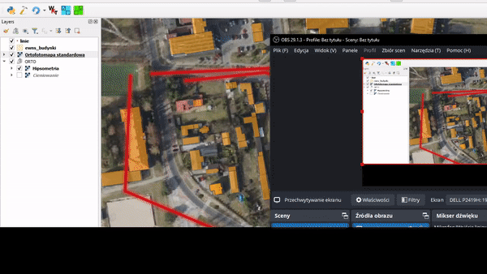

# Show And Hide Layers    

A simple QGIS plugin that allows you to turn visible vector, raster and point cloud layers on and off
 This is a useful option when vectorizing based on orthophotos, etc.

## **Tool buttons:**
* Hide / Show visible vector layers         
    
 Default shortcut Ctrl + Shift + 1

* Hide / Show visible raster layers          
    
 Default shortcut Ctrl + Shift + 2

* Hide / Show visible point cloud layers    
    
 Default shortcut Ctrl + Shift + 3

* Shortcut settings                         

## **Toolbar and shortcuts**
* Plugin actions are added to a dedicated **Show And Hide** toolbar.
* The toolbar includes vector, raster and point cloud toggle buttons, plus a separator and **Shortcut settings** (gear icon).
* Shortcuts can be changed in plugin settings (**Show And Hide > Shortcut settings**) and are saved per user.

## **Build / release note**
* Compile translations before packaging the plugin:
  * `compile_translations.bat`
* This generates `.qm` files from `i18n/*.ts`, required for runtime translations in QGIS.

 
